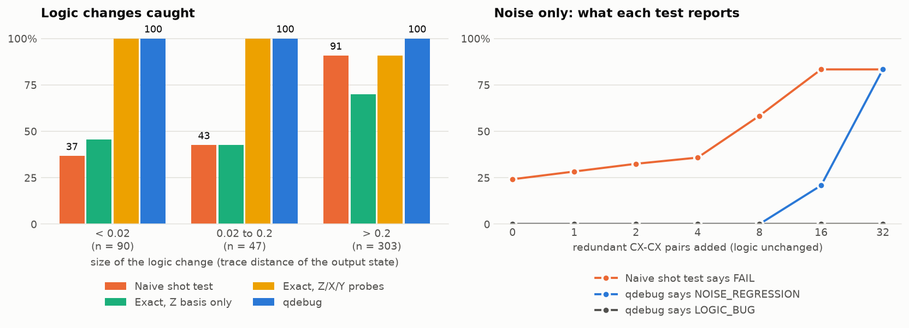

# qdebug: quantum circuit debugger + regression tester

When you change a quantum circuit and the output moves, is it a **logic bug** or just **noise**?
`qdebug` answers that by looking at every circuit two ways on a simulator (Qiskit, local Aer or the
IonQ cloud simulator) and judging the two kinds of deviation separately.

| Verdict | Meaning |
|---|---|
| `PASS` | Same circuit, same ideal behaviour, noise at baseline |
| `REFACTOR_OK` | Circuit was edited, output state is provably unchanged (e.g. `H·H`, commuting reorder) |
| `LOGIC_BUG` | The **ideal (noise-free)** output distribution changed. Reports *which edit* did it |
| `NOISE_REGRESSION` | Logic unchanged, but the change made the circuit noticeably noisier (e.g. +80 CX) |

**Learn the idea in a browser, nothing to install:** open [`docs/index.html`](docs/index.html).

* **Lesson:** eight steps, one idea each: shot noise, hardware noise, why a tolerance hides small
  bugs, the ideal view, phase bugs in the Z basis, why even Z, X and Y are not the whole state, the
  noisy view, and safe refactors. Every step has something to try on the live controls.
* **Challenge:** an edited circuit and the two views, verdict hidden. You make the call.
* **Sandbox:** preset situations plus a circuit builder (up to 4 qubits) to break things yourself.

---

## 1. How it works

```
golden circuit ──record──► snapshot.json
                            ├─ circuit (QPY) + readable instruction list
                            ├─ exact ideal distribution in Z / X / Y probe bases
                            └─ noise baseline: N seeded noisy runs → mean, std, shot-noise floor

modified circuit ──check──►  ① ideal view   (exact probs)      vs golden ideal      → LOGIC deviation
                             ② noisy view   (sampled counts)   vs its OWN ideal     → NOISE deviation
                             ③ exact statevector / unitary comparison (small circuits) → what the probes can't see
                             ④ structural diff + hunk blame                         → which edit?
                             ⑤ verdict
```

**Why two views?** The simulator can give the *exact* probabilities of the circuit as well as noisy
samples. The ideal view has no shot noise and no hardware noise, so *any* difference from the golden
ideal is a logic change, even one far below the noise floor. The noisy view is compared to the
modified circuit's **own** ideal distribution, so it measures noise and nothing else. A naive test
(noisy counts vs golden, fixed threshold) mixes these up. It false-alarms on noise and misses small
bugs; the report prints that naive result next to ours so the difference is visible.

### Pipeline details

| Step | File | What it does |
|---|---|---|
| Probe bases | `circuits.py` | Appends basis changes (Z = none, X = `H`, Y = `S†·H`) + `measure_all`. Measuring only in Z hides phase bugs (a stray `Z` before readout), so by default we measure in Z, X, Y. A basis can also be one letter per qubit (`"XZY"`); `--random-bases N` adds N seeded mixed bases, stored in the snapshot. |
| Exact equivalence | `equiv.py` | All-Z/all-X/all-Y probes are not a complete description of a state: two different states can agree on all three. So for edited circuits up to 20 qubits the output **statevectors** are compared exactly (up to global phase), and up to 10 qubits the **unitaries** too. `--equivalence state` (default) fails on a state change and only warns when just the unitary differs; `unitary` fails on both; `probes` switches the exact checks off. |
| Backends | `backends.py` | `LocalBackend` (exact statevector + Aer depolarizing noise), `IonQBackend` (IonQ cloud simulator), `QiskitBackendAdapter` (any other Qiskit backend). All expose `ideal_probs()` and `noisy_counts(shots, seed)`. |
| Snapshot | `snapshot.py` | `record()` stores the golden circuit, exact ideal distributions and a noise baseline (per-seed `mean TVD(noisy, ideal)`, its std, and the sampling-only floor from multinomial simulation). |
| Diff + blame | `diff.py` | `difflib` over instruction signatures gives *hunks*. Each hunk is re-applied **alone** to the golden circuit; hunks that move the ideal output are the culprits, ones that don't are harmless. |
| Classifier | `checker.py` | Logic: `max_basis TVD(ideal_mod, ideal_golden) > tol`, or an exact state mismatch the probes missed → `LOGIC_BUG`. Noise: `noise_dev > budget` → `NOISE_REGRESSION`, with `budget = margin·(shot_floor + (hardware_part + 3σ)·cost_ratio)`. Otherwise `REFACTOR_OK` / `PASS`. |
| Noise blame | `checker.py` | On `NOISE_REGRESSION`, ranks the edits by the noise cost they add (cost of the gates a hunk adds minus the ones it removes), so the report names the edit that made the circuit noisier. An estimate from gate counts; nothing extra is run. |
| Cost calibration | `calibrate.py` | `record --calibrate` measures the per-gate noise of 1-qubit and 2-qubit gates on the backend (identity circuits of X·X and CX·CX pairs) and stores the ratio in the snapshot, replacing the built-in guess that a 1-qubit gate costs 0.05 of a 2-qubit gate. |
| Parameter sweeps | `circuits.py` | A suite circuit with free `Parameter`s is recorded and checked at `--param-points N` (default 3) seeded points as `name@p0`, `name@p1`, ... Values depend only on the parameter's name, so golden and edited circuits always get the same angles. |
| Reports | `report.py` | Console table, JSON, Markdown, and a logic-vs-noise scatter PNG. |
| CLI | `cli.py` | `record`, `check`, `demo`, `benchmark`, `doctor`. `check` exits 1 on `LOGIC_BUG` (use in CI); `--json` / `--markdown` write reports. |

Distance metric: total variation distance (TVD) between bitstring distributions; trace distance for
the exact state comparison (an upper bound on the TVD of any measurement).

### What the demo shows (local backend, 12/12 correct)

```
case                   verdict           logic dev  noise dev/budget  naive says
ghz4_unchanged         PASS              0          0.031/0.082       ok
ghz4_extra_HH          REFACTOR_OK       0          0.031/0.082       ok
bv_oracle_reordered    REFACTOR_OK       0          0.047/0.097       ok
qft3_dead_angle        REFACTOR_OK       0          0.024/0.082       ok       <- same state, different unitary: passes with a warning
ghz4_cx_flipped        LOGIC_BUG         0.5        0.034/0.082       FAIL
ghz4_stray_Z           LOGIC_BUG         1          0.030/0.082       FAIL     <- Z-basis alone can't see it; X probe does
bv_missing_cx          LOGIC_BUG         1          0.046/0.097       FAIL
grover3_wrong_oracle   LOGIC_BUG         0.94       0.056/0.113       FAIL
qft3_phase_err_0.02    LOGIC_BUG         0.0071     0.024/0.082       ok       <- naive test blind
bell_tiny_phase_drift  LOGIC_BUG         0.00062    0.011/0.079       ok       <- naive test blind
bell_rot_s_to_sdg      LOGIC_BUG         1          0.017/0.088       ok       <- identical in Z, X and Y; exact state check catches it
ghz4_cx_padding        NOISE_REGRESSION  0          0.177/0.082       FAIL     <- naive says "bug", it's only noise
```

The last column is the point: the naive test fails both a real bug and a pure-noise change (it can't
tell them apart), and passes three real bugs: two that sit below the shot-noise floor and one
(`S` → `S†`) that turns the state into an orthogonal one without moving any all-Z, all-X or all-Y
distribution.

### Benchmark: 757 random mutants

`python -m qdebug benchmark` generates random single-edit mutants of the six demo circuits (deleted
gates, swapped control/target, wrong qubit, wrong gate, angle errors, stray rotations and Paulis,
cancelling pairs, reordered gates) and compares four tests. Ground truth is the exact output state:
440 mutants changed it, 317 did not. Full tables: [docs/benchmark/benchmark.md](docs/benchmark/benchmark.md).



| | naive shot test | exact, Z only | exact, Z/X/Y | qdebug |
|---|---|---|---|---|
| logic changes caught (440) | 75% | 62% | 94% | 100% |
| ...of the smallest ones, trace distance < 0.02 (90) | 37% | 46% | 100% | 100% |
| equivalent edits wrongly failed (317) | 25% | 0% | 0% | 0% |

How to read this honestly:

* **qdebug's 100% is by construction** on circuits this small: it compares output states exactly,
  which is also how ground truth is defined. The result is what the *other* tests miss.
* **The naive test cannot be tuned out of it.** At threshold 0.02 it misses 6% of logic changes but
  fails 89% of harmless edits; at 0.1 it fails none of them but misses 38% of the bugs.
* **All 28 misses of the Z/X/Y probes are on `bell_rot`**, a circuit built to be uniform in those
  bases. On the other five circuits the three probes catch everything.
* **Noise-only edits:** qdebug never calls redundant gates a logic bug (0 of 840 runs) and never
  flags an unpadded circuit. It reports `NOISE_REGRESSION` for 21% of runs at 16 added CX pairs and
  83% at 32. The budget is conservative, so small noise increases pass.
* **A limitation the benchmark exposed:** on `bell_rot`, noise is never detected, even at 32 pairs.
  Depolarizing noise pushes outputs towards uniform, and that circuit is already uniform in every
  probed basis. Adding mixed bases with `--random-bases` does not fix it (tried with 2 and 4: still
  0 of 20 runs flagged), because the noise score is the mean over all bases and the blind ones
  dilute the one that sees the noise. Scoring the worst basis instead of the mean is the likely fix.
* Local depolarizing noise only. Not yet run on an IonQ noise model.

---

## 2. Project layout

```
qdebug/
  stats.py        TVD, counts→probs, shot-noise floor
  circuits.py     measurement stripping, probe bases, signatures, QPY (de)serialisation
  backends.py     LocalBackend / IonQBackend / QiskitBackendAdapter
  snapshot.py     record(), save(), load()
  equiv.py        exact statevector / unitary distances (global-phase free)
  calibrate.py    measured per-gate noise cost weights
  diff.py         structural diff, hunks, hybrid circuits for blame
  checker.py      check(), Verdict, noise budget
  report.py       console / markdown / json / png
  cli.py          python -m qdebug ...
  demo_suite.py   golden circuits + injected bugs with expected verdicts
  benchmark.py    random-mutant benchmark vs naive and probe-only tests
docs/                 interactive browser demo (index.html + qdebug-demo.js, no build step)
examples/suite.py     example user suite (env-var bug toggles)
examples/snapshots/   its committed golden snapshots (what CI checks against)
notebooks/qdebug_quickstart.ipynb
tests/                pytest suite (incl. a fake qiskit-ionq provider)
```

---

## 3. Run it locally (no account needed)

```bash
python -m venv .venv && source .venv/bin/activate      # Python 3.10+
pip install -r requirements.txt                         # or: pip install -e ".[all]"

python -m pytest -q                                     # a few seconds
python -m pytest -q -m slow                             # 1,020 unchanged-circuit checks, ~35 s
python -m qdebug doctor --backend local                 # smoke test
python -m qdebug demo   --backend local --assert-all    # bug-injection demo → demo_out/report.{json,md,png}
python -m qdebug benchmark                              # 757-mutant benchmark → docs/benchmark/, ~1 min
```

Use it on your own circuits (this is the actual regression workflow):

```bash
# 1. on main: save golden behaviour (write a file with `def circuits() -> {name: QuantumCircuit}`)
python -m qdebug record --suite examples/suite.py --snapshots examples/snapshots

# 2. on your branch, after editing circuits: regress
S="--suite examples/suite.py --snapshots examples/snapshots"
python -m qdebug check $S -v                        # exit 1 on LOGIC_BUG
python -m qdebug check $S --strict                  # also fail on NOISE_REGRESSION
python -m qdebug check $S --equivalence unitary     # also fail if only the unitary changed
python -m qdebug check $S --markdown report.md      # report for a PR comment

# no-edit demo of step 2 (the example snapshots are already committed):
QDEBUG_DEMO_BUG=cx_flip python -m qdebug check $S -v
QDEBUG_DEMO_BUG=padding python -m qdebug check $S --strict
QDEBUG_DEMO_BUG=wrong_param python -m qdebug check $S -v   # bug in the parameterized ansatz
```

Commit your snapshot directory so CI can run `qdebug check`;
[`.github/workflows/qdebug-check.yml`](.github/workflows/qdebug-check.yml) does exactly that for the
example suite on every pull request and puts the Markdown report in the job summary and a PR
comment. Library use:

```python
from qdebug import make_backend, record, check
from qdebug.report import format_report

be   = make_backend("local")                       # or make_backend("ionq", noise_model="forte-1")
snap = record("my_circuit", golden_circuit, be)
print(format_report(check("my_circuit", edited_circuit, snap, be)))
```

Circuits must be unitary (measurements are added automatically; mid-circuit measurement and classical
control are rejected with a clear error).

---

## 4. Run it on IonQ's simulator (and on Qollab)

IonQ's cloud simulators (ideal, up to 29 qubits, plus the hardware noise models) are free with an
IonQ Quantum Cloud account.

1. Create an API key at <https://cloud.ionq.com/settings/keys>.
2. In whatever environment you're using (your laptop, a hosted notebook, a Qollab-provided environment):

```bash
pip install qiskit qiskit-ionq qiskit-aer numpy matplotlib
export IONQ_API_KEY="your_key"            # in a notebook:  %env IONQ_API_KEY=...  (or use getpass)

python -m qdebug doctor --backend ionq                    # connectivity + bit-order check
python -m qdebug demo   --backend ionq --noise-model forte-1 --seeds 2
python -m qdebug demo   --backend ionq --noise-model forte-1 --seeds 2 --native --calibrate
```

* Noise models: `forte-1`, `forte-enterprise-1` (current), `aria-1`, `aria-2` (legacy). Pass with `--noise-model`.
* The demo submits ~50 small jobs (batched per circuit). `--seeds 2` and `--bases ZX` reduce that.
* **Notebook route (hosted environments):** open `notebooks/qdebug_quickstart.ipynb`. It prompts for
  the key with `getpass`, falls back to the local simulator if you skip it, and runs the demo.
* **A different simulator provided by the hackathon platform?** Wrap any Qiskit backend:

```python
from qdebug import QiskitBackendAdapter, record, check
be = QiskitBackendAdapter(platform_backend)      # noisy counts from it, exact ideal probs computed locally
```

**IonQ-specific behaviour built in**

* Ideal probabilities come from `job.get_probabilities()` (exact; `get_counts()` on the ideal simulator
  would re-sample and add shot noise).
* Noisy runs use `backend.set_options(noise_model=..., sampler_seed=...)` for reproducible noise.
* Circuits are transpiled to `qiskit_ionq`'s accepted gate list at `optimization_level=0`.
* `doctor`/`check` cross-check IonQ's ideal output against local exact simulation and **warn on
  mismatch** (e.g. bit-ordering), so a wrong convention can't silently flip verdicts.
* `--native` sends the **noisy** runs in IonQ's native gates (`gpi`, `gpi2`, and `ms` or `zz` depending
  on the noise model), translated gate by gate, so the cloud compiler cannot cancel redundant gates
  before their noise is measured. Ideal runs stay on the default gateset. Use it together with
  `--calibrate`, which measures nothing on the default gateset if IonQ cancels the calibration pairs.
* Default logic tolerance is `1e-4` on IonQ (probabilities travel over the API) vs `1e-9` locally;
  override with `--logic-tol`.

---

## 5. Honest status and limitations

* **Tested:** the suite passes locally (`pytest`), including 1,020 repeated checks of unchanged
  circuits (6 circuits x 170 noise seeds, `-m slow`) with zero false alarms, and the full IonQ code path against a **fake** `qiskit-ionq` provider that
  mimics its documented API (options, job shapes).
* **Not yet exercised against live IonQ**: this was built without an IonQ API key. Run
  `qdebug doctor --backend ionq` first; it is designed to expose bit-order or API surprises immediately.
  `IONQ_API_KEY=... python -m pytest -m ionq -v` then checks the assumptions the fake provider encodes.
* **The pull-request workflow has not run on GitHub yet** (nothing has been pushed).
* **The browser demo is a teaching aid, not the tool.** It re-implements the method in JavaScript for
  circuits of up to four qubits (seven gate types) with depolarizing noise. The page itself was
  exercised in headless Chromium (every lesson step, 40 challenge rounds, the builder) but has no
  automated UI test in the repo. `tests/test_web_demo.py` checks it against Qiskit
  (ideal, to 1e-12), Qiskit Aer (noisy, to 1e-9) and the Python verdicts; that test needs Node.js.
* **Exact equivalence is a small-circuit feature**: statevectors up to 20 qubits, unitaries up to 10.
  Above that, "behaviour identical" rests on the probe bases (a warning says so); 4 random mixed bases
  are added automatically when recording circuits that wide.
* **Qollab:** I could not find public documentation of Qollab's own runtime, so the instructions above
  rely only on what is documented for IonQ + Qiskit. Check your hackathon's Qollab page for how keys or
  credits are provisioned.
* **IonQ compiles abstract-gate circuits server-side.** The padding demo (`ghz4_cx_padding`, 80 redundant
  CX) is guaranteed on the local backend; IonQ's optimizer may cancel the redundant pairs, in which case
  you'll see `REFACTOR_OK` (also a correct answer: nothing extra is executed). `--native` is meant to
  prevent that. Its translation is tested offline (every gate kept, unitary unchanged, for both `ms`
  and `zz`), but **no native-gate job has been submitted to IonQ yet**.
* The noise budget scales hardware noise by a cost ratio (2q-gate-dominated). `--calibrate` measures
  the weights and recovers the true ratio on the local backend; it has not been run on an IonQ noise
  model. IonQ notes its noise models are approximations and shouldn't be used to predict specific
  hardware results.
* Noise blame is an estimate from gate counts, not a measurement of each edit.
* Local noise is a plain depolarizing model (`--p1/--p2`); good for development, not hardware-faithful.
* Exact local ideal simulation is limited to 24 qubits; IonQ's ideal simulator goes to 29.

## 6. Ideas for the remaining hackathon hours

See [ROADMAP.md](ROADMAP.md) for the plan and what is done. Still open:

1. Stabilizer-based equivalence for wide Clifford circuits, beyond the 20-qubit exact limit.
2. Measured noise blame: run each edit alone under the noise model instead of estimating from gate counts.
3. Mid-circuit measurement and classical control.

## License

MIT, see [LICENSE](LICENSE).
